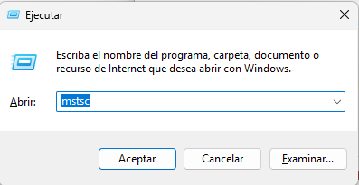
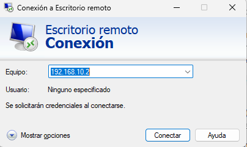
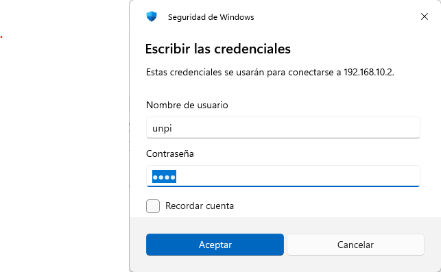
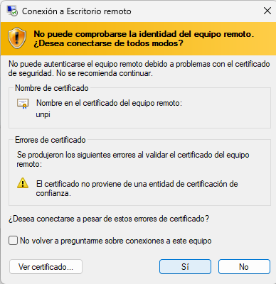
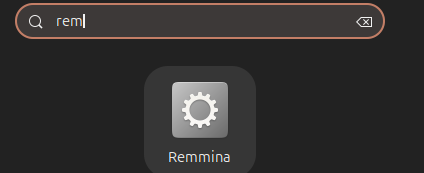
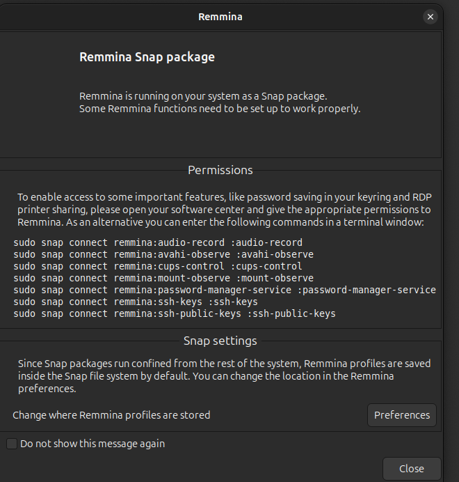
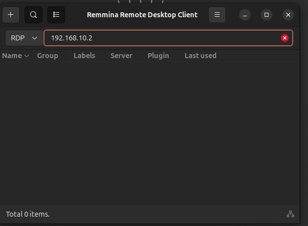
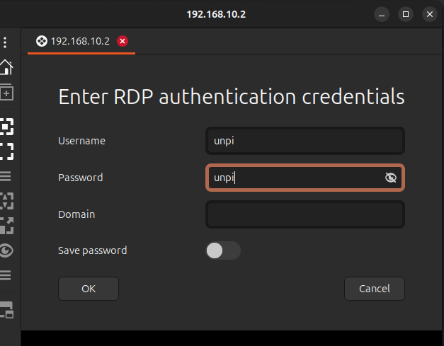

# Guía: Conexión a la Raspberry Pi con Escritorio remoto (RDP) desde Windows y Linux

**Autor:** Johan Alejandro López Arias ([@ElJoho](https://github.com/ElJoho))

Esta guía explica cómo ver y controlar el escritorio de la Raspberry Pi del kit del PhantomX Pincher desde un computador con **Windows** o **Linux**, usando un cable Ethernet directo y el protocolo **RDP** (Remote Desktop Protocol).

- En la Raspberry Pi se usa **Escritorio remoto de GNOME** (`gnome-remote-desktop`), que ya viene con Ubuntu.
- En **Windows** se usa **Conexión a Escritorio remoto** (`mstsc`), que ya viene con Windows.
- En **Linux** se usa **Remmina**, software libre (licencia GNU GPL), sin versión de pago ni cuenta.

> ℹ️ Esta guía reemplaza a la guía de NoMachine. NoMachine es software propietario; RDP ya viene incluido en Ubuntu y en Windows, y en Linux se usa un cliente libre.

---

## Requisitos previos

- Computador con Windows o Linux.
- Raspberry Pi del kit, energizada, con Ubuntu 26.04. La imagen del kit ya trae la Raspberry configurada: **no hay que configurar nada en la Raspberry**, empieza en la sección 1. (El [anexo A](#anexo-a-configuración-de-la-raspberry-pi-solo-para-preparar-la-imagen) al final es solo para quien prepare una Raspberry nueva.)
- Cable Ethernet. Si tu computador no tiene puerto Ethernet, necesitarás un **adaptador USB → Ethernet**.

| Dato | Valor |
|---|---|
| IP de la Raspberry Pi | `192.168.10.2` |
| IP del PC (adaptador Ethernet) | `192.168.10.1` |
| Máscara de subred | `255.255.255.0` (`/24`) |
| Puerto RDP | `3389` |
| Usuario / contraseña | `unpi` / `unpi` |

---

## 1. Conectar la Raspberry Pi físicamente

1. Energizar la Raspberry Pi del kit.
2. Conectarla por **cable Ethernet directamente al computador**.
3. Esperar a que termine de arrancar (alrededor de un minuto).

---

## 2. Configurar el adaptador de red del PC

La Raspberry Pi tiene la IP estática **`192.168.10.2`**. Para que el computador la pueda alcanzar, debes asignarle al adaptador Ethernet del PC la IP **`192.168.10.1`**, en la misma subred.

### 2.1 En Windows

1. Buscar *"Panel de control"* en el menú de inicio de Windows.

   

2. En el Panel de control, hacer clic en **Redes e Internet**.

   

3. Clic en **Centro de redes y recursos compartidos**.

   

4. En el panel lateral izquierdo, clic en **Cambiar configuración del adaptador**. Aparecerá la conexión Ethernet (probablemente como *"Red no identificada"*):

   

5. Doble clic sobre la conexión Ethernet. Se abrirá la ventana **Estado de Ethernet** → clic en **Propiedades**.

   

6. En la lista, seleccionar **Protocolo de Internet versión 4 (TCP/IPv4)** y clic en **Propiedades**.

   

7. Por defecto el adaptador estará configurado para obtener IP automáticamente:

   

   Cambiar a **Usar la siguiente dirección IP** y configurar:

   | Campo | Valor |
   |-------|-------|
   | Dirección IP | `192.168.10.1` |
   | Máscara de subred | `255.255.255.0` |
   | Puerta de enlace predeterminada | *(vacío)* |

   

   > **Nota:** Si al abrir esta ventana los campos aparecen grises o con valores antiguos cargados, hacer clic en el campo **Dirección IP** y volver a escribir `192.168.10.1` para activarlos.

8. Aceptar todas las ventanas y cerrar el Panel de control.

### 2.2 En Linux

En Linux se crea una **conexión nueva solo para la Raspberry Pi**, en vez de modificar la conexión cableada que ya tengas. Así tu conexión normal (por ejemplo, al router de tu casa) sigue funcionando igual, y solo eliges la de la Raspberry cuando la uses.

#### Paso 1: identificar el puerto Ethernet

Conecta el cable (y el adaptador USB → Ethernet si lo usas) y ejecuta:

```bash
nmcli device status
```

Busca la línea de tipo `ethernet`. Su nombre (columna `DEVICE`) suele ser `enp…` o `eth0` para un puerto integrado, o `enx…` para un adaptador USB. Por ejemplo:

```
DEVICE           TYPE      STATE         CONNECTION
enp4s0           ethernet  connected     Wired connection 1
wlo1             wifi      connected     MiWiFi
```

Aquí el puerto es `enp4s0`. Si no aparece ninguna línea `ethernet`, el adaptador USB no fue reconocido: prueba otro puerto USB.

#### Paso 2: crear la conexión "Raspberry Pi kit"

**Opción A, con la terminal (recomendada).** Cambia `enp4s0` por el nombre del paso 1:

```bash
sudo nmcli connection add type ethernet ifname enp4s0 con-name "Raspberry Pi kit"   ipv4.method manual ipv4.addresses 192.168.10.1/24 ipv6.method disabled
sudo nmcli connection up "Raspberry Pi kit"
```

- `ifname enp4s0`: la conexión solo se usa en ese puerto.
- `ipv4.method manual ipv4.addresses 192.168.10.1/24`: IP fija del PC, en la misma red que la Raspberry (`192.168.10.2`).
- No lleva puerta de enlace: el PC sigue usando su Wi-Fi para internet.

**Opción B, con la interfaz gráfica** (Ubuntu y otros escritorios GNOME):

1. *Configuración → Red*. En la sección **Cableada** (o **Ethernet**) haz clic en **+** para añadir una conexión.
2. Pestaña **Identidad**: Nombre `Raspberry Pi kit`.
3. Pestaña **IPv4**: Método **Manual**; Dirección `192.168.10.1`, Máscara de red `255.255.255.0`, Puerta de enlace vacía.
4. **Añadir**. Luego, en la sección Cableada, selecciona **Raspberry Pi kit** como conexión activa.

> ℹ️ **Para volver a tu conexión normal** (por ejemplo, al conectar el cable al router de tu casa), activa tu conexión de siempre: `nmcli connection up "Wired connection 1"` (en un Ubuntu en español puede llamarse `Conexión cableada 1`; `nmcli connection show` lista los nombres), o elígela en *Configuración → Red*. Para la Raspberry: `nmcli connection up "Raspberry Pi kit"`.

> 💡 **(Opcional) Compartir el internet del PC con la Raspberry.** Si quieres que la Raspberry tenga internet a través del cable (por ejemplo, para `apt install` o `git pull` sin Wi-Fi), usa el método `shared` en lugar de `manual`:
> ```bash
> sudo nmcli connection modify "Raspberry Pi kit" ipv4.method shared ipv4.addresses 192.168.10.1/24
> sudo nmcli connection up "Raspberry Pi kit"
> ```
> La Raspberry también debe usar `192.168.10.1` como puerta de enlace y DNS (`sudo nmcli connection modify <conexión> ipv4.gateway 192.168.10.1 ipv4.dns 192.168.10.1` en la Raspberry).

### 2.3 Comprobar la conexión

Desde el PC (en Windows: *Símbolo del sistema* o *PowerShell*; en Linux: terminal):

```bash
ping 192.168.10.2
```

Debe responder. Si no responde, revisa el cable en ambos extremos y la IP del PC.

---

## 3. Conectarse

### 3.1 Desde Windows (Conexión a Escritorio remoto)

1. Presionar **Windows + R**, escribir `mstsc` y presionar **Aceptar** (o buscar *"Conexión a Escritorio remoto"* en el menú de inicio).

   

   > ⚠️ Si Windows dice que no encuentra `mstsc`, la aplicación no está instalada (desde Windows 11 23H2 se puede desinstalar, y en algunos equipos falta). Ver la sección 4.

2. En **Equipo** escribir `192.168.10.2` → **Conectar**.

   

3. En **Escribir las credenciales**: usuario `unpi`, contraseña `unpi` → **Aceptar**. Si aparece otra cuenta ya escrita: **Más opciones → Usar otra cuenta**.

   

4. Aparece una advertencia de certificado (es el certificado de la Raspberry, anexo A.2) → **Sí** (puedes marcar "No volver a preguntarme sobre conexiones a este equipo").

   

5. Se abre el escritorio de la Raspberry Pi; úsalo con tu mouse y teclado.

### 3.2 Desde Linux (Remmina)

**Paso 1: instalar Remmina** (si no lo tienes):

- Ubuntu: desde el **Centro de aplicaciones** (App Center), buscando *Remmina*, o con `sudo snap install remmina`. También `sudo apt install remmina`.
- Fedora: `sudo dnf install remmina`
- Cualquier distribución: `flatpak install flathub org.remmina.Remmina`

Todas estas versiones ya incluyen el soporte para RDP.

**Paso 2: conectarse.**

1. Abre **Remmina** (en Ubuntu: tecla **Super** y escribe `rem`).

   

2. Si Remmina se instaló como Snap (Centro de aplicaciones), la primera vez muestra el aviso **Remmina Snap package** con unos permisos opcionales (guardar contraseñas en el llavero, impresoras, etc.). Para conectarse a la Raspberry no hacen falta: clic en **Close** (puedes marcar *Do not show this message again*).

   

3. En la ventana principal, deja **RDP** en el selector de la izquierda, escribe `192.168.10.2` en la barra y presiona **Enter**.

   

4. En **Enter RDP authentication credentials** escribe usuario `unpi` y contraseña `unpi` (deja **Domain** vacío) → **OK**. Con **Save password** activado no la vuelve a pedir.

   

> 💡 Los textos de Remmina pueden aparecer en inglés o en español según el idioma del PC (por ejemplo *Enter RDP authentication credentials*, *Username*, *Password*).

**(Opcional) Guardar un perfil**, para no escribir la IP cada vez: en Remmina, clic en **+** (arriba a la izquierda) y llena:

| Campo | Valor |
|---|---|
| Name (Nombre) | `Raspberry Pi kit` (cualquier nombre) |
| Protocol (Protocolo) | **RDP - Remote Desktop Protocol** |
| Server (Servidor) | `192.168.10.2` |
| Username (Nombre de usuario) | `unpi` |
| Password (Contraseña) | `unpi` |
| Color depth (Profundidad de color) | **Automatic (32 bpp)** |

Luego **Save and Connect** (*Guardar y conectar*). Las siguientes veces basta con doble clic en el perfil de la lista.

> ⚠️ **No uses una profundidad de color de 16 bits.** El Escritorio remoto de GNOME necesita el modo gráfico GFX (32 bits) y cierra la conexión si el cliente no lo usa.

**Paso 3: aceptar el certificado.** La primera vez Remmina muestra el certificado de la Raspberry (el del anexo A.2) y pregunta si confías en él → **Sí / Aceptar**. Remmina lo recuerda por dirección: si la IP de la Raspberry cambia, volverá a preguntar.

**Las siguientes veces:** abre Remmina y escribe otra vez `192.168.10.2` (o haz doble clic en el perfil guardado). Recuerda activar antes la conexión de red "Raspberry Pi kit" (sección 2.2).

**Durante la conexión**, la barra de herramientas de Remmina (a un lado de la ventana) permite:

- **Escalar** (*Toggle scaled mode*): ajusta el escritorio de la Raspberry al tamaño de la ventana; útil porque su pantalla puede ser pequeña.
- **Pantalla completa** y **Desconectar**.

> ℹ️ También funciona **Conexiones** de GNOME (`gnome-connections`), eligiendo RDP.

---

## 4. Si no se conecta

| Problema | Qué hacer |
|---|---|
| (Windows) *"Windows no puede encontrar 'mstsc'"* | La aplicación Conexión a Escritorio remoto no está instalada. Primero prueba **Windows + R** → `C:\Windows\System32\mstsc.exe`. Si tampoco abre, descarga el instalador oficial de Microsoft (64 bits en casi todos los PC) desde [esta página](https://learn.microsoft.com/es-es/windows-server/remote/remote-desktop-services/remotepc/uninstall-remote-desktop-connection), ejecútalo con una cuenta de administrador y vuelve a la sección 3.1. |
| `ping 192.168.10.2` no responde | Revisa el cable y la IP del PC (sección 2). En la Raspberry: `hostname -I` debe mostrar `192.168.10.2`. |
| Remmina dice que falló el inicio de sesión, o la conexión se cierra al entrar | La pantalla de la Raspberry puede estar bloqueada: desbloquéala con un teclado conectado a la Raspberry y revisa el anexo A.3. Revisa también que la profundidad de color de Remmina no sea de 16 bits. |
| (Linux) `ping` no responde aunque el cable está bien | Revisa que la conexión activa en el puerto Ethernet sea **Raspberry Pi kit** (`nmcli device status`) y actívala con `nmcli connection up "Raspberry Pi kit"`. |
| Deja de funcionar después de reiniciar | Revisa el inicio de sesión automático y el llavero sin contraseña (anexo A.3). |
| Sin monitor no conecta | Anexo A.4 (`cat /sys/class/drm/card1-HDMI-A-2/status` debe decir `connected`). |
| El monitor no muestra imagen | Conéctalo al puerto **HDMI0** de la placa, no al HDMI1 (anexo A.4). |
| Revisar el servicio en la Raspberry | `grdctl status` (RDP debe estar `enabled`) y `ss -tln \| grep 3389` (debe aparecer el puerto). |
| Reiniciar el servicio | `systemctl --user restart gnome-remote-desktop` |

---

## 5. Uso básico una vez conectado

### 5.1 Terminal

- **Autocompletar:** escribe las primeras letras de un archivo o carpeta y presiona **Tab**. Si hay varias opciones, **Tab dos veces** las lista.
- **Limpiar la pantalla:** `clear`
- **Varios paneles:** la Raspberry trae **Terminator**, que permite abrir varias terminales en una misma ventana; muy útil para ROS 2.

### 5.2 Actualizar el repositorio y compilar

```bash
cd ~/ros2/KIT_Phantom_X_Pincher_ROS2
git pull
cd phantom_ws
MAKEFLAGS="-j2" colcon build --parallel-workers 1
source install/setup.bash
```

La compilación con `MAKEFLAGS="-j2"` y `--parallel-workers 1` evita que una Raspberry de 4 GB se quede sin RAM. Ver la [guía de Setup](readme.md#7-clonar-y-compilar-phantom_ws).

### 5.3 Editar desde tu computador

Mantener el escritorio remoto abierto mientras trabajas en tu PC consume CPU de la Raspberry. Para editar código es más liviano abrir los archivos de la Raspberry como una carpeta en tu PC con **Samba** y editarlos con los programas de tu PC: la Raspberry solo entrega los archivos. Ver la [guía de Samba](guiaSamba.md) (Windows: unidad de red; Linux: sección 16).

### 5.4 Apagar la Raspberry Pi correctamente

1. En el escritorio remoto, clic en el menú de la esquina superior derecha → **Apagar**.
2. Esperar a que se apague por completo.
3. Recién entonces desenergizarla.

> **Nunca** desconectes la alimentación sin apagar primero: corres riesgo de corromper la tarjeta SD.

---

## Resumen rápido

| Acción | Comando / Valor |
|--------|----------------|
| IP de la Raspberry Pi | `192.168.10.2` |
| IP del PC (adaptador Ethernet) | `192.168.10.1` |
| Máscara de subred | `255.255.255.0` |
| Usuario / contraseña | `unpi` / `unpi` |
| Windows | **Windows + R** → `mstsc` → `192.168.10.2` |
| Linux | Remmina → **RDP** → `192.168.10.2` |
| Estado del servicio (Raspberry) | `grdctl status` |
| OS de la Raspberry | Ubuntu 26.04 LTS |

---

## Anexo A. Configuración de la Raspberry Pi (solo para preparar la imagen)

> ℹ️ **Los estudiantes no necesitan este anexo.** La imagen del sistema de las Raspberry del kit ya trae todo esto configurado. Es una referencia para quien prepare una Raspberry Pi nueva o vuelva a crear la imagen. Se hace (una sola vez) **en la propia Raspberry** (con monitor, teclado y mouse, o por SSH donde se indique), con el usuario `unpi`.

### A.1 IP estática en el puerto Ethernet

Ver el nombre de la conexión cableada (por ejemplo `netplan-eth0` o `Wired connection 1`):

```bash
nmcli -f NAME,DEVICE,TYPE connection show
```

Asignar la IP `192.168.10.2` a esa conexión (cambia `"netplan-eth0"` por el nombre que apareció):

```bash
sudo nmcli connection modify "netplan-eth0" ipv4.method manual ipv4.addresses 192.168.10.2/24
sudo nmcli connection up "netplan-eth0"
hostname -I     # debe aparecer 192.168.10.2
```

- **¿Qué hace?** Deja fija la IP del puerto Ethernet para que el PC siempre la encuentre en la misma dirección. El Wi-Fi no cambia.

### A.2 Activar el Escritorio remoto (RDP)

```bash
# Certificado TLS para cifrar la conexión (válido 10 años)
mkdir -p ~/.local/share/gnome-remote-desktop
openssl req -new -newkey rsa:4096 -days 3650 -nodes -x509 -subj "/CN=$(hostname)" \
  -keyout ~/.local/share/gnome-remote-desktop/rdp-tls.key \
  -out ~/.local/share/gnome-remote-desktop/rdp-tls.crt

# Configurar y activar RDP
grdctl rdp set-tls-cert ~/.local/share/gnome-remote-desktop/rdp-tls.crt
grdctl rdp set-tls-key  ~/.local/share/gnome-remote-desktop/rdp-tls.key
grdctl rdp set-credentials unpi unpi
grdctl rdp disable-view-only
grdctl rdp enable
systemctl --user enable --now gnome-remote-desktop.service

# Comprobar
grdctl status
```

- `set-credentials unpi unpi`: usuario y contraseña que se escriben al conectarse desde el PC.
- `disable-view-only`: permite **controlar** la Raspberry (mouse y teclado), no solo verla.
- `grdctl status` debe mostrar RDP como `enabled`.

> ⚠️ Las credenciales del RDP se guardan en el llavero de GNOME como "GNOME Remote Desktop RDP credentials". **No borres ni edites ese elemento** en *Contraseñas y claves*; si pasa, vuelve a ejecutar `grdctl rdp set-credentials unpi unpi`.

### A.3 Que funcione siempre, también después de reiniciar

El Escritorio remoto comparte la sesión de escritorio que está abierta, así que la Raspberry debe iniciar sesión sola y no bloquear la pantalla:

1. **Inicio de sesión automático:** *Configuración → Sistema → Usuarios → Inicio de sesión automático* activado para `unpi`. Equivale a poner en `/etc/gdm3/custom.conf`, sección `[daemon]`:
   ```
   AutomaticLoginEnable=true
   AutomaticLogin=unpi
   ```
2. **Llavero sin contraseña:** con el inicio de sesión automático, GNOME no puede desbloquear el llavero donde están las credenciales del RDP. Déjalo sin contraseña con el script del repositorio (pide la contraseña actual, `unpi`):
   ```bash
   python3 ~/ros2/KIT_Phantom_X_Pincher_ROS2/guias/Setup/scripts/vaciar_contrasena_llavero.py
   ```
3. **Sin bloqueo de pantalla:** si la pantalla se bloquea, GNOME corta el RDP y rechaza nuevas conexiones (Remmina lo muestra como error de inicio de sesión).
   ```bash
   gsettings set org.gnome.desktop.screensaver lock-enabled false
   gsettings set org.gnome.desktop.screensaver ubuntu-lock-on-suspend false
   gsettings set org.gnome.desktop.lockdown disable-lock-screen true
   gsettings set org.gnome.desktop.session idle-delay 0
   ```
4. **(Opcional) Menos uso de CPU:** desactivar las animaciones.
   ```bash
   gsettings set org.gnome.desktop.interface enable-animations false
   ```

### A.4 Sin monitor conectado (pantalla virtual de 1328x748 a 15 fps)

El Escritorio remoto solo comparte una pantalla que exista. Si la Raspberry no tiene monitor, no hay pantalla y la conexión falla.

**Cómo está en la imagen del kit:** el puerto **HDMI1** de la placa (en Linux se llama `HDMI-A-2`) se fuerza como conectado, y se le da un archivo **EDID** (los datos que normalmente envía un monitor para decir qué resoluciones acepta) que solo ofrece **1328x748 a 15 fps** (casi 16:9). Una pantalla pequeña y a pocos fps hace que la Raspberry use menos CPU para enviar la imagen por RDP.

> ℹ️ ¿Por qué 1328x748? Es la pantalla más pequeña, con forma casi 16:9, en la que cabe completa la ventana de **DYNAMIXEL Wizard 2.0** (no se puede hacer más baja de 678 píxeles; 748 = 678 + la barra superior de GNOME + la barra de título). RViz también cabe con el texto a tamaño normal. ¿Por qué 15 fps? Es lo mínimo con lo que escribir y mover ventanas todavía se siente fluido; el puntero del ratón lo dibuja el PC, así que se mueve suave igual.

> ℹ️ ¿Por qué hace falta el archivo EDID? Sin monitor, Linux no sabe qué resoluciones usar e inventa una lista estándar (1024x768, 848x480, 800x600, todas a unos 60 fps). Con el archivo EDID se puede elegir exactamente 1328x748 a 15 fps, y solo ese modo.

Para hacerlo en una Raspberry nueva:

1. Copiar el archivo EDID que está en este repositorio ([`scripts/1328x748-15.bin`](scripts/1328x748-15.bin), 128 bytes, un solo modo: 1328x748 a 15,000 Hz):
   ```bash
   cd ~/ros2/KIT_Phantom_X_Pincher_ROS2
   sudo mkdir -p /lib/firmware/edid
   sudo cp guias/Setup/scripts/1328x748-15.bin /lib/firmware/edid/
   ```
2. Guardar una copia de `cmdline.txt` y añadir al **final de su única línea** (separado por un espacio) `drm.edid_firmware=HDMI-A-2:edid/1328x748-15.bin video=HDMI-A-2:1328x748@15D`:
   ```bash
   sudo cp /boot/firmware/current/cmdline.txt /boot/firmware/current/cmdline.txt.bak
   sudo sed -i '1 s#$# drm.edid_firmware=HDMI-A-2:edid/1328x748-15.bin video=HDMI-A-2:1328x748@15D#' /boot/firmware/current/cmdline.txt
   cat /boot/firmware/current/cmdline.txt
   ```
   La última línea mostrada debe terminar en `... video=HDMI-A-2:1328x748@15D` y el archivo debe seguir teniendo **una sola línea**. Luego reiniciar (`sudo reboot`).
3. Comprobar, sin monitor conectado:
   ```bash
   cat /sys/class/drm/card1-HDMI-A-2/status   # debe decir: connected
   cat /sys/class/drm/card1-HDMI-A-2/modes    # debe decir solo: 1328x748
   ```
   y conectarse por RDP (sección 3): el escritorio debe verse a 1328x748. Para ver los fps: *Configuración → Pantallas* debe mostrar una frecuencia de 15,00 Hz.

**Deshacer:** `sudo cp /boot/firmware/current/cmdline.txt.bak /boot/firmware/current/cmdline.txt` y reiniciar.

> ℹ️ **Si la Raspberry ya tenía la pantalla anterior** (848x480 a 24 fps, archivo `848x480-24.bin`), no hace falta repetir el paso 2 completo: después del paso 1, cambiar solo el modo:
> ```bash
> sudo cp /boot/firmware/current/cmdline.txt /boot/firmware/current/cmdline.txt.bak
> sudo sed -i 's|edid/848x480-24.bin video=HDMI-A-2:848x480@24D|edid/1328x748-15.bin video=HDMI-A-2:1328x748@15D|' /boot/firmware/current/cmdline.txt
> ```

> ⚠️ **Si conectas un monitor**, usa el puerto **HDMI0** de la placa (en Linux `HDMI-A-1`), que no tiene este cambio. Un monitor en el puerto **HDMI1** recibe el modo de 1328x748 a 15 fps, y la mayoría de monitores no lo muestran bien o no lo muestran. Con un monitor en HDMI0, GNOME ve dos pantallas (el monitor y la pantalla virtual de HDMI1); se puede elegir cuál usar en *Configuración → Pantallas*.

> 💡 Otra opción, sin tocar `cmdline.txt`, es un "HDMI dummy plug" (emulador de pantalla), pero usa la resolución que traiga el adaptador (normalmente 1920x1080 a 60 fps), que gasta más CPU.
