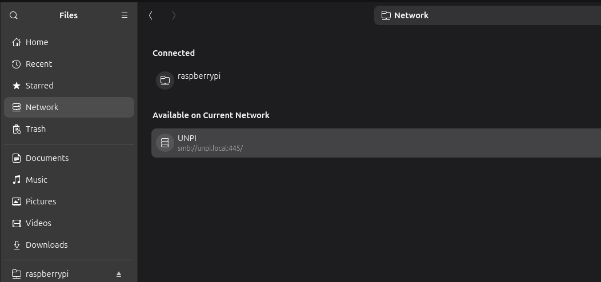
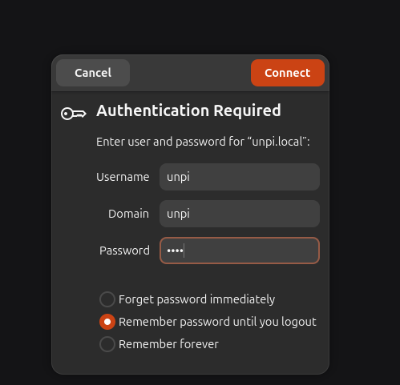
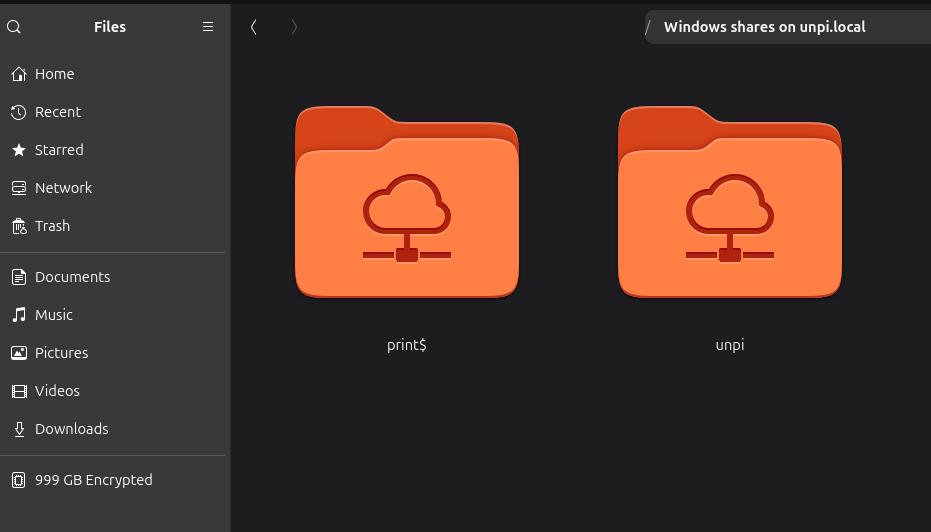

# Compartir archivos con la Raspberry Pi mediante Samba

**Autor:** Johan Alejandro López Arias ([@ElJoho](https://github.com/ElJoho))


<details>
  <summary>
    <b>Video tutorial</b> — <a href="https://www.youtube.com/watch?v=cnAaOMN6Adk">Como usar Samba para conectarse a raspberry pi</a>
  </summary>
</details>
<br>


Esta guía explica cómo montar un servidor **Samba** en la Raspberry Pi del kit del PhantomX Pincher con **Ubuntu 26.04** para acceder a sus carpetas desde un PC con **Windows 11** (como una unidad de red) o con **Linux** (como una carpeta más, sección 16).

Samba solo entrega archivos: la Raspberry Pi casi no gasta CPU ni RAM, porque los programas con los que abres y editas los archivos corren en tu PC.

Es ideal para mover archivos pesados entre la Raspberry Pi y el computador, por ejemplo:

* Mallas CAD o archivos STL.
* Archivos grandes de ROS 2.
* Carpetas completas de proyectos.
* Archivos que quieras copiar arrastrando y soltando desde el explorador de archivos de Windows o Linux.

---

## Datos de conexión

| Campo                                    | Valor            |
| ---------------------------------------- | ---------------- |
| **Usuario de la Raspberry Pi**           | `unpi`           |
| **Usuario de Samba**                     | `unpi`           |
| **IP de la Raspberry Pi**                | `192.168.10.2`   |
| **IP del PC por Ethernet**               | `192.168.10.1`   |
| **Máscara de subred**                    | `255.255.255.0`  |
| **Contraseña de Samba**                  | `unpi`           |
| **Sistema operativo de la Raspberry Pi** | Ubuntu 26.04 LTS |

> La Raspberry Pi ya debe tener la IP estática `192.168.10.2`. Si ya seguiste la [guía de Escritorio remoto](conexionEscritorioRemoto.md) para conexión directa por Ethernet, tu adaptador Ethernet (en Windows o Linux) debería estar en `192.168.10.1`. Ambos equipos quedan en la misma subred y no necesitas configurar nada más de red.

---

## Cómo funciona Samba

Samba es una implementación libre del protocolo **SMB/CIFS**, que es el protocolo usado por Windows para compartir archivos en red.

En este caso:

* La Raspberry Pi funciona como **servidor Samba**.
* Windows funciona como **cliente SMB**.
* Windows monta una carpeta de la Raspberry Pi como una unidad de red, por ejemplo `Z:`.

```text
Windows 11 (192.168.10.1)            Raspberry Pi (192.168.10.2)
─────────────────────────            ───────────────────────────
Explorador de archivos               Servidor Samba
Unidad de red Z:         ◄──────►     /home/unpi/
        │                   SMB3             ▲
        └──── lee / escribe ─────────────────┘
       Conexión Ethernet directa, sin router
```

Windows 11 usa normalmente **SMB2/SMB3**. No es necesario activar SMB1.

> **Concepto importante:** Samba tiene su propia base de datos de usuarios y contraseñas. Aunque el usuario `unpi` ya exista en Linux, también hay que registrarlo en Samba con `smbpasswd`.

---

## Requisitos previos

Antes de empezar, asegúrate de tener:

* Raspberry Pi 5 encendida.
* Ubuntu 26.04 LTS instalado en la Raspberry Pi.
* Cable Ethernet directo entre la Raspberry Pi y el PC (Windows 11 o Linux).
* IP de la Raspberry Pi: `192.168.10.2`.
* IP del adaptador Ethernet del PC: `192.168.10.1`.
* Acceso a la terminal de la Raspberry Pi, ya sea por:

  * Escritorio remoto (RDP).
  * SSH.
  * Monitor y teclado conectados directamente.

Si usas SSH, puedes entrar con:

```bash
ssh unpi@192.168.10.2
```

---

## 1. Instalar Samba en la Raspberry Pi

Conéctate a la terminal de la Raspberry Pi y actualiza los paquetes:

```bash
sudo apt update && sudo apt upgrade -y
```

Instala Samba:

```bash
sudo apt install samba -y
```

También es recomendable instalar `smbclient`, porque permite probar Samba desde la misma Raspberry Pi:

```bash
sudo apt install smbclient -y
```

Verifica la versión instalada de Samba:

```bash
smbd --version
```

Deberías ver algo parecido a:

```text
Version 4.23.x
```

---

## 2. Elegir la carpeta a compartir

En esta guía se compartirá el **home completo** del usuario `unpi`:

```text
/home/unpi
```

Esto permite acceder fácilmente a proyectos, videos, archivos de ROS 2 y otros documentos.

Verifica que `unpi` sea el propietario de su carpeta personal:

```bash
sudo chown unpi:unpi /home/unpi
```

> Si prefieres compartir una carpeta más limitada, puedes crear una carpeta dedicada:

```bash
mkdir -p /home/unpi/compartido
```

En ese caso, en la configuración de Samba usarías esta ruta:

```text
/home/unpi/compartido
```

En esta guía se usará `/home/unpi`.

---

## 3. Configurar Samba

El archivo principal de configuración de Samba está en:

```text
/etc/samba/smb.conf
```

Primero crea una copia de seguridad del archivo original:

```bash
sudo cp /etc/samba/smb.conf /etc/samba/smb.conf.bak
```

Abre el archivo de configuración:

```bash
sudo nano /etc/samba/smb.conf
```

Ve hasta el final del archivo y añade este bloque:

```ini
[unpi]
   comment = Archivos de la Raspberry Pi (PhantomX Pincher)
   path = /home/unpi
   browseable = yes
   read only = no
   writable = yes
   valid users = unpi
   create mask = 0664
   directory mask = 0775
   force user = unpi
```

Guarda y cierra el archivo.

En `nano`:

```text
Ctrl + O
Enter
Ctrl + X
```

---

### 3.1 (Recomendado) Ofrecer Samba solo por el cable Ethernet

Si la Raspberry Pi también está conectada a una red Wi-Fi (por ejemplo, la de tu casa o la de la universidad), por defecto Samba ofrecería `/home/unpi` también en esa red, protegido solo por la contraseña `unpi`. Para que solo responda por el cable:

```bash
sudo sed -i '/^\[global\]/a\   interfaces = lo eth0\n   bind interfaces only = yes' /etc/samba/smb.conf
```

Esto añade dos líneas debajo de `[global]` en `smb.conf`:

```ini
   interfaces = lo eth0
   bind interfaces only = yes
```

- `interfaces = lo eth0`: Samba solo escucha en la propia Raspberry (`lo`) y en el puerto Ethernet (`eth0`).
- `bind interfaces only = yes`: no responde en ninguna otra interfaz (Wi-Fi incluido).

Después de reiniciar Samba (sección 7) puedes comprobarlo con `sudo ss -lntp | grep -E ':(445|139)\b'`: deben aparecer solo `127.0.0.1`, `[::1]` y `192.168.10.2`.

---

## 4. Explicación de la configuración

| Parámetro               | Función                                                          |
| ----------------------- | ---------------------------------------------------------------- |
| `[unpi]`                | Nombre del recurso compartido que verá Windows.                  |
| `comment`               | Descripción del recurso compartido.                              |
| `path`                  | Carpeta real de la Raspberry Pi que se compartirá.               |
| `browseable`            | Permite que el recurso sea visible al navegar.                   |
| `read only = no`        | Permite escritura.                                               |
| `writable = yes`        | Permite escritura.                                               |
| `valid users = unpi`    | Solo el usuario `unpi` puede acceder.                            |
| `create mask = 0664`    | Permisos para archivos nuevos.                                   |
| `directory mask = 0775` | Permisos para carpetas nuevas.                                   |
| `force user = unpi`     | Fuerza que los archivos creados queden como propiedad de `unpi`. |

> En Ubuntu, los archivos creados desde Samba pueden quedar con permisos diferentes a los de Raspberry Pi OS. Por eso se usan `create mask = 0664` y `directory mask = 0775`.

---

## 5. Validar la configuración de Samba

Después de editar `smb.conf`, valida la configuración:

```bash
testparm
```

Cuando pida presionar `Enter`, hazlo.

Debe aparecer algo parecido a:

```text
Loaded services file OK.
```

También deberías ver la sección `[unpi]` en la salida.

---

## 6. Crear el usuario de Samba

Aunque el usuario `unpi` ya exista en Ubuntu, hay que registrarlo también en Samba.

Ejecuta:

```bash
sudo smbpasswd -a unpi
```

Te pedirá una contraseña. Para esta guía se usará:

```text
unpi
```

Luego habilita explícitamente el usuario Samba:

```bash
sudo smbpasswd -e unpi
```

> Si olvidas habilitar el usuario con `sudo smbpasswd -e unpi`, Windows puede mostrar errores de acceso aunque la contraseña sea correcta.

---

## 7. Reiniciar y habilitar los servicios de Samba

Reinicia los servicios de Samba:

```bash
sudo systemctl restart smbd nmbd
```

Habilítalos para que arranquen automáticamente con la Raspberry Pi:

```bash
sudo systemctl enable smbd nmbd
```

Comprueba que `smbd` esté activo:

```bash
sudo systemctl status smbd --no-pager
```

Debe aparecer:

```text
Active: active (running)
```

---

## 8. Abrir Samba en el firewall de la Raspberry Pi

Comprueba si el firewall UFW está activo:

```bash
sudo ufw status verbose
```

Si aparece:

```text
Status: inactive
```

no necesitas hacer nada más.

Si aparece como activo, permite Samba:

```bash
sudo ufw allow Samba
sudo ufw reload
```

---

## 9. Verificar Samba desde la Raspberry Pi

Antes de probar desde Windows, verifica que Samba funciona desde la propia Raspberry Pi.

Comprueba que Samba está escuchando en los puertos `445` y `139`:

```bash
sudo ss -lntp | grep -E ':(445|139)\b'
```

Lo esperado es ver:

```text
0.0.0.0:445
0.0.0.0:139
```

Luego lista los recursos compartidos usando `localhost`:

```bash
smbclient -L localhost -U unpi
```

Introduce la contraseña de Samba:

```text
unpi
```

Deberías ver algo parecido a:

```text
Sharename       Type      Comment
---------       ----      -------
print$          Disk      Printer Drivers
unpi            Disk      Archivos de la Raspberry Pi (PhantomX Pincher)
IPC$            IPC       IPC Service
```

Si ves el recurso `unpi` en la lista, Samba está bien configurado en la Raspberry Pi.

---

## 10. Verificar la red desde Windows

En Windows, abre PowerShell y prueba que el PC puede comunicarse con la Raspberry Pi:

```powershell
ping 192.168.10.2
```

Debe responder sin pérdida de paquetes:

```text
Paquetes: enviados = 4, recibidos = 4, perdidos = 0
```

Luego verifica el puerto SMB `445`:

```powershell
Test-NetConnection 192.168.10.2 -Port 445
```

Lo importante es que aparezca:

```text
TcpTestSucceeded : True
```

Si `ping` funciona y `TcpTestSucceeded` es `True`, entonces:

* La conexión Ethernet directa funciona.
* Windows llega a la Raspberry Pi.
* El puerto SMB está abierto.
* Samba está disponible desde Windows.

---

## 11. Conectar desde Windows 11

En algunas configuraciones, intentar abrir directamente esta ruta en el Explorador de archivos:

```text
\\192.168.10.2\unpi
```

puede fallar con un mensaje como:

```text
Windows no encuentra '\\192.168.10.2\unpi'
```

Esto no necesariamente significa que Samba esté mal. Si `ping` funciona y `Test-NetConnection` al puerto `445` devuelve `True`, el método más confiable es montar la unidad directamente con `net use`.

---

## 12. Método recomendado: montar la unidad con PowerShell

Abre PowerShell en Windows y ejecuta:

```powershell
net use Z: \\192.168.10.2\unpi /user:unpi unpi /persistent:no
```

Si todo está correcto, debe aparecer:

```text
Se ha completado el comando correctamente.
```

Después abre el Explorador de archivos y entra a:

```text
Z:
```

La carpeta `/home/unpi` de la Raspberry Pi aparecerá como una unidad de red en Windows.

---

## 13. Hacer que la unidad sea permanente

Cuando hayas comprobado que funciona, puedes hacer que Windows intente reconectar la unidad automáticamente al iniciar sesión:

```powershell
net use Z: \\192.168.10.2\unpi /user:unpi unpi /persistent:yes
```

Con esto, la unidad `Z:` quedará guardada.

> Nota: si la Raspberry Pi no está conectada cuando inicies Windows, la unidad puede aparecer como desconectada hasta que la Raspberry vuelva a estar disponible.

---

## 14. Método alternativo: usar el Explorador de archivos

Después de confirmar que `net use` funciona, también puedes intentar abrir directamente la ruta desde el Explorador de archivos.

Abre el Explorador de archivos y escribe en la barra de direcciones:

```text
\\192.168.10.2\unpi
```

Cuando pida credenciales, usa:

```text
Usuario: unpi
Contraseña: unpi
```

También puedes asignar la unidad desde la interfaz gráfica:

1. Abre el Explorador de archivos.

2. Clic en el menú `...`.

3. Selecciona **Conectar a unidad de red**.

4. Elige una letra, por ejemplo `Z:`.

5. En **Carpeta**, escribe:

   ```text
   \\192.168.10.2\unpi
   ```

6. Marca **Conectar de nuevo al iniciar sesión** si quieres que sea persistente.

7. Introduce las credenciales de Samba.

---

## 15. Verificación final

Desde Windows:

1. Abre la unidad `Z:`.
2. Crea un archivo de prueba, por ejemplo:

   ```text
   prueba_desde_windows.txt
   ```

Desde la Raspberry Pi, verifica que el archivo aparece en `/home/unpi`:

```bash
ls -l /home/unpi
```

Ahora prueba al revés.

Desde la Raspberry Pi:

```bash
touch /home/unpi/prueba_desde_raspberry.txt
```

Desde Windows, verifica que el archivo aparece en la unidad `Z:`.

Si puedes crear archivos desde ambos lados, Samba quedó funcionando correctamente.

---

## 16. Conectar desde Linux

Los pasos 1 a 9 (en la Raspberry Pi) son los mismos para Windows y Linux. Desde un PC con Linux hay dos formas: montar la carpeta de la Raspberry como una carpeta normal del PC (16.2, recomendado; solo necesita el paquete `cifs-utils`) o abrirla en el explorador de archivos (16.3, no hay que instalar nada).

### 16.1 Red del PC

El adaptador Ethernet del PC debe tener la IP `192.168.10.1`. Si todavía no lo configuraste, sigue la sección **2.2 En Linux** de la [guía de Escritorio remoto](conexionEscritorioRemoto.md#22-en-linux) (crea una conexión "Raspberry Pi kit" sin tocar tu conexión normal).

Comprueba que el PC ve a la Raspberry y que el puerto de Samba responde:

```bash
ping -c 3 192.168.10.2
nc -zv 192.168.10.2 445        # debe decir "succeeded" u "open"
```

### 16.2 Método recomendado: montarla como una carpeta normal (`cifs`)

Los archivos de la Raspberry aparecen en una carpeta del PC (`~/raspberrypi`) y se pueden abrir con cualquier programa (VS Code, el explorador de archivos, la terminal) como si fueran locales.

**Montar** (en una terminal del PC):

```bash
sudo apt install cifs-utils          # solo la primera vez
mkdir -p ~/raspberrypi               # carpeta de montaje (solo la primera vez)
sudo mount -t cifs //192.168.10.2/unpi ~/raspberrypi -o username=unpi,uid=$(id -u),gid=$(id -g)
ls ~/raspberrypi
```

Primero pide la contraseña de `sudo` (la de tu PC) y luego la contraseña de Samba:

```text
Password for unpi@//192.168.10.2/unpi:
```

Escribe `unpi` (no se ve mientras escribes) y presiona Enter. Si todo salió bien, `ls ~/raspberrypi` muestra las carpetas de la Raspberry:

```text
Desktop  Documents  Downloads  Music  Pictures  Public  ROBOTIS  Templates  Videos  ros2  snap
```

y el repositorio del kit queda en `~/raspberrypi/ros2/KIT_Phantom_X_Pincher_ROS2`.

| Opción | Función |
|---|---|
| `//192.168.10.2/unpi` | IP de la Raspberry y nombre de la carpeta compartida (`/home/unpi`). |
| `~/raspberrypi` | Carpeta del PC donde aparecen los archivos. Mientras no esté montada, está vacía. |
| `username=unpi` | Usuario de Samba. |
| `uid=$(id -u),gid=$(id -g)` | Los archivos aparecen como tuyos en el PC, así puedes editarlos sin `sudo`. |

**Desmontar** (cuando termines, y siempre antes de desconectar el cable o apagar la Raspberry):

```bash
cd ~                          # salir de la carpeta si una terminal está dentro de ella
sudo umount ~/raspberrypi
```

> ℹ️ **Notas sobre desmontar:**
> - Si dice `target is busy`, algún programa todavía tiene la carpeta abierta: una terminal dentro de `~/raspberrypi` (usa `cd ~`), VS Code, el explorador de archivos, etc. Ciérralos y vuelve a intentarlo.
> - Si desconectaste el cable o apagaste la Raspberry sin desmontar, los programas que usaban la carpeta pueden quedarse esperando. Desmóntala con `sudo umount -l ~/raspberrypi`.
> - Para comprobar si está montada: `mount | grep raspberrypi` (si no muestra nada, no está montada).
> - El montaje no se mantiene al reiniciar el PC: para volver a usarla, repite el comando `sudo mount ...` de arriba. La carpeta `~/raspberrypi` no hace falta crearla otra vez.

### 16.3 Método alternativo: el explorador de archivos (Archivos / Nautilus)

No hay que instalar nada: Linux detecta solo la Raspberry en la red.

1. Abre **Archivos** y, en el panel izquierdo, haz clic en **Red** (*Network*). En **Disponible en la red actual** (*Available on Current Network*) aparece la Raspberry como **UNPI** (`smb://unpi.local:445/`). Haz clic en ella.

   

2. En **Autenticación requerida** (*Authentication Required*) escribe `unpi` en los tres campos → **Conectar** (*Connect*):

   | Campo | Valor |
   |---|---|
   | Nombre de usuario (*Username*) | `unpi` |
   | Dominio (*Domain*) | `unpi` |
   | Contraseña (*Password*) | `unpi` |

   Elige **Recordar para siempre** (*Remember forever*) si no quieres escribirla cada vez.

   

3. Aparecen las carpetas compartidas de la Raspberry. Abre **unpi**: es la carpeta `/home/unpi` (`print$` es para impresoras, no la uses).

   

4. Para desconectarla, clic en el botón de expulsar ⏏ junto a su nombre en el panel izquierdo.

> 💡 Si **UNPI** no aparece en **Red**, escribe la dirección directamente: en Archivos presiona **Ctrl + L**, escribe `smb://192.168.10.2/unpi` y presiona Enter. Con la carpeta abierta, **Ctrl + D** la añade a los marcadores del panel izquierdo.

En otros escritorios (KDE Dolphin, Thunar, etc.) la dirección es la misma: `smb://192.168.10.2/unpi`.

### 16.4 Verificación

Desde Linux, crea un archivo en la carpeta de la Raspberry (con el método 16.2: `touch ~/raspberrypi/prueba_desde_linux.txt`), y en la Raspberry comprueba que aparece:

```bash
ls -l /home/unpi/prueba_desde_linux.txt
```

Luego puedes borrarlo (`rm ~/raspberrypi/prueba_desde_linux.txt`).

---

# Solución de problemas

## 1. `net use` funciona, pero `net view \\192.168.10.2` falla con error 53

Este caso fue confirmado en esta configuración.

El comando:

```powershell
net view \\192.168.10.2
```

puede fallar con:

```text
Error de sistema 53.

No se ha encontrado la ruta de acceso de la red.
```

Pero el montaje directo puede funcionar correctamente:

```powershell
net use Z: \\192.168.10.2\unpi /user:unpi unpi /persistent:no
```

Si ese comando muestra:

```text
Se ha completado el comando correctamente.
```

entonces Samba está funcionando.

En esta guía se recomienda usar `net use` como método principal.

---

## 2. Windows dice que no encuentra `\\192.168.10.2\unpi`

Primero verifica que hay conexión con la Raspberry Pi:

```powershell
ping 192.168.10.2
```

Luego verifica el puerto SMB:

```powershell
Test-NetConnection 192.168.10.2 -Port 445
```

Si aparece:

```text
TcpTestSucceeded : True
```

monta directamente con:

```powershell
net use Z: \\192.168.10.2\unpi /user:unpi unpi /persistent:no
```

---

## 3. Acceso denegado o contraseña incorrecta

En la Raspberry Pi, vuelve a registrar y habilitar el usuario Samba, y reinicia el servicio:

```bash
sudo smbpasswd -a unpi
sudo smbpasswd -e unpi
sudo systemctl restart smbd nmbd
```

Si Windows guardó credenciales antiguas, bórralas desde la interfaz gráfica:

1. Abre el **Panel de control**.
2. Entra a **Cuentas de usuario**.
3. Abre **Administrador de credenciales**.
4. Entra a **Credenciales de Windows**.
5. Elimina entradas relacionadas con:

   ```text
   192.168.10.2
   ```

Luego intenta montar otra vez:

```powershell
net use Z: \\192.168.10.2\unpi /user:unpi unpi /persistent:no
```

---

## 4. Revisar logs de Samba

Justo después de intentar conectarte desde Windows, revisa los logs:

```bash
sudo journalctl -u smbd -n 80 --no-pager
```

---

# Diagnóstico confirmado en esta instalación

En esta configuración se confirmó lo siguiente:

* La Raspberry Pi tenía la IP correcta en Ethernet:

  ```text
  eth0    UP    192.168.10.2/24
  ```

* Windows tenía la IP correcta en Ethernet:

  ```text
  192.168.10.1
  ```

* La Raspberry Pi también estaba conectada por Wi-Fi:

  ```text
  wlan0   UP    192.168.0.7/24
  ```

  Esto no afecta la conexión directa por Ethernet.

* Samba estaba activo:

  ```text
  Active: active (running)
  ```

* Samba estaba escuchando en todas las interfaces:

  ```text
  0.0.0.0:445
  0.0.0.0:139
  ```

* El firewall UFW estaba inactivo:

  ```text
  Status: inactive
  ```

* Windows podía hacer ping a la Raspberry Pi:

  ```text
  Paquetes: enviados = 4, recibidos = 4, perdidos = 0
  ```

* Windows podía alcanzar el puerto SMB:

  ```text
  TcpTestSucceeded : True
  ```

* El comando `net view` fallaba:

  ```powershell
  net view \\192.168.10.2
  ```

  con:

  ```text
  Error de sistema 53.
  No se ha encontrado la ruta de acceso de la red.
  ```

* Pero el montaje directo sí funcionaba:

  ```powershell
  net use Z: \\192.168.10.2\unpi /user:unpi unpi /persistent:no
  ```

  con:

  ```text
  Se ha completado el comando correctamente.
  ```

Por eso, para esta guía, el método recomendado en Windows 11 es montar directamente con `net use`.

---

# Resumen rápido

| Acción                          | Comando / valor                                                  |
| ------------------------------- | ---------------------------------------------------------------- |
| IP de la Raspberry Pi           | `192.168.10.2`                                                   |
| IP del PC por Ethernet          | `192.168.10.1`                                                   |
| Usuario Samba                   | `unpi`                                                           |
| Contraseña Samba                | `unpi`                                                           |
| Instalar Samba                  | `sudo apt install samba -y`                                      |
| Instalar cliente de prueba      | `sudo apt install smbclient -y`                                  |
| Editar configuración            | `sudo nano /etc/samba/smb.conf`                                  |
| Validar configuración           | `testparm`                                                       |
| Crear usuario Samba             | `sudo smbpasswd -a unpi`                                         |
| Habilitar usuario Samba         | `sudo smbpasswd -e unpi`                                         |
| Reiniciar Samba                 | `sudo systemctl restart smbd nmbd`                               |
| Ver estado de Samba             | `sudo systemctl status smbd --no-pager`                          |
| Ver puertos Samba               | `sudo ss -lntp \| grep -E ':(445\|139)\b'`                       |
| Probar conexión desde Windows   | `ping 192.168.10.2`                                              |
| Probar puerto SMB desde Windows | `Test-NetConnection 192.168.10.2 -Port 445`                      |
| Montar unidad temporal          | `net use Z: \\192.168.10.2\unpi /user:unpi unpi /persistent:no`  |
| Montar unidad permanente        | `net use Z: \\192.168.10.2\unpi /user:unpi unpi /persistent:yes` |
| Ruta para Explorador            | `\\192.168.10.2\unpi`                                            |
| Montar desde Linux              | `sudo mount -t cifs //192.168.10.2/unpi ~/raspberrypi -o username=unpi,uid=$(id -u),gid=$(id -g)` |
| Desmontar en Linux              | `sudo umount ~/raspberrypi`                                      |
| Conectar desde Linux (Archivos) | `smb://192.168.10.2/unpi`                                        |

---

# Recursos

* Documentación oficial de Samba.
* Documentación de Ubuntu Server sobre Samba.
* Documentación de Microsoft sobre SMB en Windows.